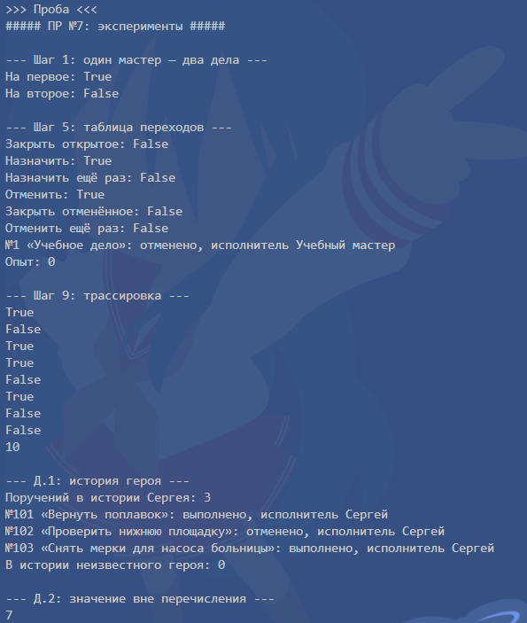
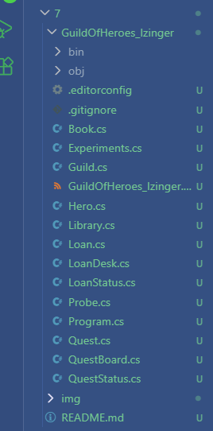
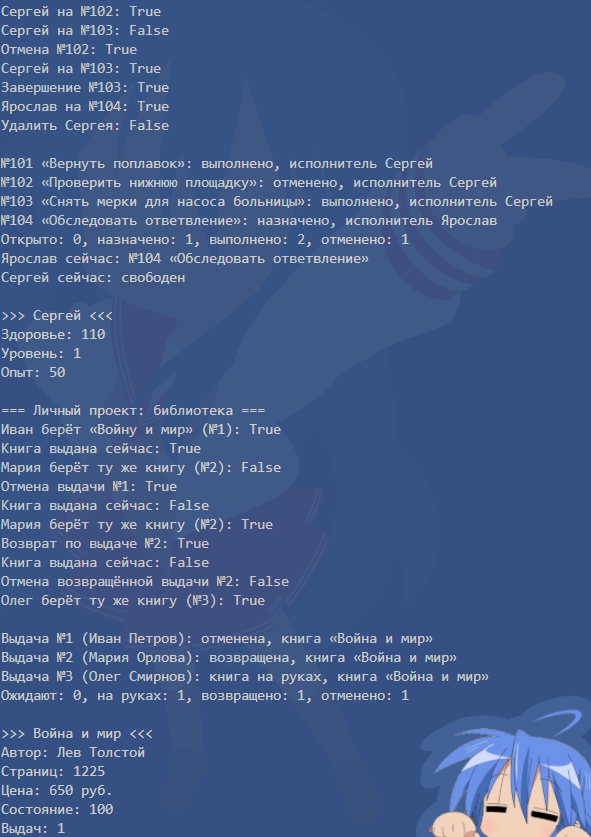

# Практическая работа № 15

Автор: Изингер Алексей  
Группа: ИСП-242  


## Приложение 

Проект: `GuildOfHeroes_Izinger` — консольное приложение на C# (.NET 9).  
Личный проект («Собственный проект»): **«Библиотека»** — классы `Book`, `Library`, `Loan`, `LoanStatus`, `LoanDesk` (состояния выдачи).

## Состав проекта

```text
7
├── GuildOfHeroes_Izinger
│   ├── .editorconfig
│   ├── .gitignore
│   ├── Book.cs
│   ├── Experiments.cs
│   ├── Guild.cs
│   ├── GuildOfHeroes_Izinger.csproj
│   ├── Hero.cs
│   ├── Library.cs
│   ├── Loan.cs
│   ├── LoanDesk.cs
│   ├── LoanStatus.cs
│   ├── Probe.cs
│   ├── Program.cs
│   ├── Quest.cs
│   ├── QuestBoard.cs
│   └── QuestStatus.cs
|
├── img
│  
└── README.md
```


## Запуск

Нужен .NET SDK 9

```bash
cd GuildOfHeroes_Izinger
dotnet build
dotnet run
```

Основной сценарий выводит сначала результат работы с героями, затем блок «Личный проект: библиотека». Пробы, трассировки, примеры «двух ошибок» и дополнительная часть собраны в `Experiments.cs`: чтобы их выполнить, уберите `//` перед `Experiments.Run();` в начале `Program.cs`, запустите `dotnet run`, после проверки верните `//`. Файл `Probe.cs` по правилу курса содержит в `Run` одну строку, а `// Probe.Run();` закомментирована.

## Практическая работа №7

Тема: состояния объекта — перечисление, переходы и вычисляемая занятость. Добавлен `QuestStatus.cs` (`Open`, `Assigned`, `Completed`, `Cancelled`); в `Quest` признак `IsCompleted` заменён одним свойством `Status`, добавлены `TryCancel`, `GetStatusText`, новый формат `GetInfo`; в `QuestBoard` добавлены `TryCancel`, `GetQuests` (копия списка), `IsAssigned` (занятость вычисляется), `TryRemoveMember`, а также `CountByStatus`, `FindActiveQuest`, `GetQuestsOf`. В `Hero` полей занятости не появилось.

### Таблица переходов поручения

| Сейчас | `TryAssign` | `TryComplete` | `TryCancel` |
| --- | --- | --- | --- |
| `Open` | → `Assigned` | отказ | → `Cancelled` |
| `Assigned` | отказ | → `Completed` | → `Cancelled` |
| `Completed` | отказ | отказ | отказ |
| `Cancelled` | отказ | отказ | отказ |

Конечные состояния: `Completed` и `Cancelled`.

### Ответы на вопросы

1. **Почему два признака `bool` хуже одного перечисления?** Два `bool` дают четыре сочетания, и одно из них (`IsCompleted = true` и `IsCancelled = true`) в жизни невозможно, но код его допускает — достаточно забыть одну проверку. Чтобы отличить «открыто» от «назначено», понадобился бы ещё и `AssignedHero`: три места отвечают на один вопрос. Перечисление хранит ровно одно из четырёх допустимых значений, а опечатка в имени значения — ошибка компиляции.
2. **Какие состояния поручения конечные и почему?** `Completed` и `Cancelled`: из них нет переходов, все три метода (`TryAssign`, `TryComplete`, `TryCancel`) дают отказ. Выполненное дело нельзя отменить, отменённое — выполнить; история дела не меняется.
3. **Куда делась проверка `AssignedHero != null` в `Quest.TryAssign`?** В состоянии `Open` исполнителя нет по определению: его ставит только этот метод и сразу переводит дело в `Assigned`. Одна проверка `Status != QuestStatus.Open` заменила две старые (`IsCompleted` и `AssignedHero != null`).
4. **Где хранится занятость героя?** Нигде отдельно — она вычисляется. `QuestBoard.IsAssigned(hero)` ищет поручение со состоянием `Assigned` и тем же героем (сравнение ссылок). Поле `IsBusy` дублировало бы то, что уже записано в поручениях, и могло бы с ними разойтись.
5. **Почему проверку занятости нельзя делать после назначения?** `quest.TryAssign(hero)` уже изменит поручение, и герой будет занят именно им; доска вернёт `false`, хотя состояние уже изменено — ответ и состояние разойдутся. Проверка идёт до вызова, который меняет состояние.
6. **Почему доска не даёт удалить Сергея?** На него ссылаются поручения №101, №102 и №103. `TryRemoveMember` не смотрит на состояние: любая ссылка (в том числе в выполненных и отменённых делах) запрещает удаление, чтобы история не вела к человеку, которого нет в гильдии.

### Ход работы

- Шаги 1–2. Проба показала проблему: до исправления оба назначения мастера возвращали `True`. Причина: каждое поручение проверяет только себя, доска о занятости не спрашивает. Лишние `bool`-признаки не добавлялись.
- Шаги 3–4. Создан `QuestStatus`; `Quest` переведён на `Status`; `TryAssign` — только из `Open`, `TryComplete` — только из `Assigned`, `TryCancel` — из `Open` или `Assigned` (`&&` в проверке отказа). `AssignedHero` при отмене не стирается: карточка помнит, кого снимали с дела. Метод `GetStatusText` содержит ветку `default`.
- Шаг 5. `QuestBoard.TryCancel`, `GetQuests` (копия), проверка `Status != Open` в `AddQuest`. Проба переходов выполнена (блок «Шаг 5»).
- Шаг 6. `QuestBoard.IsAssigned` и проверка в `TryAssign` перед `quest.TryAssign(hero)`; повтор пробы шага 1 теперь даёт `True` и `False`.
- Шаг 7. `TryRemoveMember` — удаление участника через доску только при отсутствии ссылок поручений.
- Шаг 8. День Сергея: №101 выполнено, №102 назначено → отменено, №103 выполнено (опыт 30 + 20 = 50), №104 — Ярослав; «Удалить Сергея: False».

### Трассировка (шаг 9)

Прогноз до запуска и состояния поручений №1 / №2 после каждого вызова:

| № | Вызов | Вывод | №1 | №2 |
| ---: | --- | --- | --- | --- |
| 1 | `TryAssign(1, "Иван")` | `True` | Assigned | Open |
| 2 | `TryAssign(2, "Иван")` | `False` (Иван занят №1) | Assigned | Open |
| 3 | `TryComplete(1)` | `True` (+10 опыта) | Completed | Open |
| 4 | `TryAssign(2, "Иван")` | `True` (первое выполнено, Иван свободен) | Completed | Assigned |
| 5 | `TryCancel(1)` | `False` (выполненное не отменяется) | Completed | Assigned |
| 6 | `TryCancel(2)` | `True` (назначенное отменяется) | Completed | Cancelled |
| 7 | `TryComplete(2)` | `False` (отменённое не закрывается) | Completed | Cancelled |
| 8 | `IsAssigned(ivan)` | `False` (нет ни одного `Assigned` с Иваном) | Completed | Cancelled |
| 9 | `ivan.Experience` | `10` (награда только за первое) | Completed | Cancelled |

Фактический вывод (блок «Шаг 9» в `Experiments.Run()`) совпал с прогнозом: `True False True True False True False False 10`, расхождений нет.

### Две ошибки (шаг 10)

**Ошибка 1. Занят навсегда.** В сокращённом `IsAssigned` условие `quest.AssignedHero == hero` не проверяет состояние. Ссылка на Сергея осталась в выполненном №101, поэтому любое старое дело делает героя «занятым», и уже первая строка даёт «Сергей на №102: False». Исправление: `quest.Status == QuestStatus.Assigned && quest.AssignedHero == hero`.

**Ошибка 2. Сначала назначили, потом спросили.** `quest.TryAssign(hero)` выполняется первым и меняет поручение (оно становится `Assigned` с этим героем). Затем `IsAssigned(hero)` находит именно это поручение — герой «занят» им самим — и доска возвращает `false`, хотя состояние уже изменено. Поэтому ответ `False`, а в списке №102 и №103 оба «назначено, исполнитель Сергей». Исправление: проверка занятости — до вызова, который меняет состояние.

### Самостоятельный шаг (шаг 11)

**11.1.** `QuestBoard.CountByStatus(QuestStatus status)` только считает и ничего не меняет. Сводка из четырёх вызовов: `Открыто: 0, назначено: 1, выполнено: 2, отменено: 1`.

**11.2.** `QuestBoard.FindActiveQuest(string heroName)`: герой ищется через гильдию (не найден → `null`), затем возвращается поручение в состоянии `Assigned` с этим героем (иначе `null`). В `Program` результат проверяется на `null` перед чтением `Id` и `Title`: «Ярослав сейчас: №104 «Обследовать ответвление»», «Сергей сейчас: свободен».
*Можно ли переписать `IsAssigned` в одну строку через новый метод?* Формально да: `return FindActiveQuest(hero.Name) != null;`. Но тогда занятость зависела бы от поиска по имени в гильдии: для героя, которого нет в составе (или двойника с тем же именем), результат был бы неточным. Поэтому в проекте оставлен прямой обход поручений со сравнением ссылок.

### Личный проект: «Библиотека»

Операции «выдача книги» из №6 даны состояния:

```text
LoanStatus { Open, Active, Returned, Cancelled }
```

| Сейчас | `TryStart` | `TryFinish` | `TryCancel` |
| --- | --- | --- | --- |
| `Open` (ожидает выдачи) | → `Active` | отказ | → `Cancelled` |
| `Active` (книга на руках) | отказ | → `Returned` | → `Cancelled` |
| `Returned` | отказ | отказ | отказ |
| `Cancelled` | отказ | отказ | отказ |

Признак `IsReturned` заменён на `LoanStatus Status`; старт — только из начального состояния, завершение — только из рабочего, отмена — из начального или рабочего. `LoanDesk.IsLent(Book)` **вычисляет**, выдана ли книга: ищет выдачу в состоянии `Active` с той же книгой. Поля «выдана» в `Book` нет. `LoanDesk.TryStart` отказывает, если книга выдана; `AddLoan` принимает только выдачи в состоянии `Open`; `GetLoans` возвращает копию списка; `CountByStatus` считает по состоянию.

В `Program`: первый старт — `True`, второй для той же книги — `False`, после отмены первой выдачи — снова `True`.

- *Какие состояния операции конечные?* `Returned` и `Cancelled`.
- *Почему занятость вычисляется, а не хранится?* Информация о том, выдана ли книга, уже записана в выдачах (состояние `Active` + ссылка на книгу). Отдельное поле «выдана» в `Book` пришлось бы включать и выключать в каждом методе (старт, возврат, отмена, любой будущий) — стоит забыть один раз, и книга «выдана» навсегда. Вычисляемое значение всегда согласовано с выдачами.

### Вывод программы (`dotnet run`)

```text
>>> Гильдия героев: участников 5 <<<

Сергей на №102: True
Сергей на №103: False
Отмена №102: True
Сергей на №103: True
Завершение №103: True
Ярослав на №104: True
Удалить Сергея: False

№101 «Вернуть поплавок»: выполнено, исполнитель Сергей
№102 «Проверить нижнюю площадку»: отменено, исполнитель Сергей
№103 «Снять мерки для насоса больницы»: выполнено, исполнитель Сергей
№104 «Обследовать ответвление»: назначено, исполнитель Ярослав
Открыто: 0, назначено: 1, выполнено: 2, отменено: 1
Ярослав сейчас: №104 «Обследовать ответвление»
Сергей сейчас: свободен

>>> Сергей <<<
Здоровье: 110
Уровень: 1
Опыт: 50
```


Вывод личного проекта:

```text
=== Личный проект: библиотека ===
Иван берёт «Войну и мир» (№1): True
Книга выдана сейчас: True
Мария берёт ту же книгу (№2): False
Отмена выдачи №1: True
Книга выдана сейчас: False
Мария берёт ту же книгу (№2): True
Возврат по выдаче №2: True
Книга выдана сейчас: False
Отмена возвращённой выдачи №2: False
Олег берёт ту же книгу (№3): True

Выдача №1 (Иван Петров): отменена, книга «Война и мир»
Выдача №2 (Мария Орлова): возвращена, книга «Война и мир»
Выдача №3 (Олег Смирнов): книга на руках, книга «Война и мир»
Ожидают: 0, на руках: 1, возвращено: 1, отменено: 1

>>> Война и мир <<<
Автор: Лев Толстой
Страниц: 1225
Цена: 650 руб.
Состояние: 100
Выдач: 1
```


### Дополнительная часть

**Д.1. История героя.** `QuestBoard.GetQuestsOf(string heroName)` возвращает все поручения, где герой был исполнителем, в любом состоянии: у Сергея их три (№101, №102, №103). Для истории состояние проверять не нужно: она отвечает на вопрос «где герой работал когда-либо», и подходит любая ссылка, в том числе в выполненных и отменённых делах. Для занятости нужен только текущий момент, поэтому важно состояние `Assigned`.

**Д.2. Значение, которого нет.** `(QuestStatus)7` напечатало число `7`: перечисление внутри — целое число, и приведением можно получить значение, для которого нет имени. Ветка `default` в `GetStatusText` нужна компилятору, который требует вернуть строку при любом значении, а не только при четырёх перечисленных; она же защищает от «чужих» чисел (например, из файла или приведения типа). Учебный код удалён из основного сценария (он выполняется только в `Experiments`).

Весь вывод экспериментов:

```text
##### ПР №7: эксперименты #####

--- Шаг 1: один мастер — два дела ---
На первое: True
На второе: False

--- Шаг 5: таблица переходов ---
Закрыть открытое: False
Назначить: True
Назначить ещё раз: False
Отменить: True
Закрыть отменённое: False
Отменить ещё раз: False
№1 «Учебное дело»: отменено, исполнитель Учебный мастер
Опыт: 0

--- Шаг 9: трассировка ---
True
False
True
True
False
True
False
False
10

--- Д.1: история героя ---
Поручений в истории Сергея: 3
№101 «Вернуть поплавок»: выполнено, исполнитель Сергей
№102 «Проверить нижнюю площадку»: отменено, исполнитель Сергей
№103 «Снять мерки для насоса больницы»: выполнено, исполнитель Сергей
В истории неизвестного героя: 0

--- Д.2: значение вне перечисления ---
7
```

## Скриншоты






